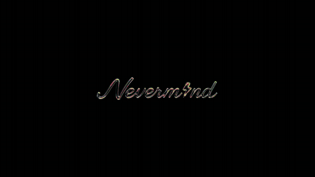

  

<h1 align="center">Nevermind</h1>

  <i align="center">The command palette that extends itself</i>

> [!IMPORTANT]
> This app is in Alpha. Expect bugs.

  
    
  <i>An AI-native desktop command palette that extends itself.</i>
    
   <a href="https://github.com/pablopunk/nvm/releases">Get the latest release</a>

