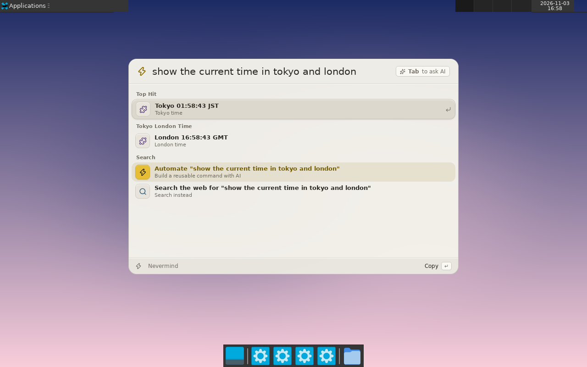
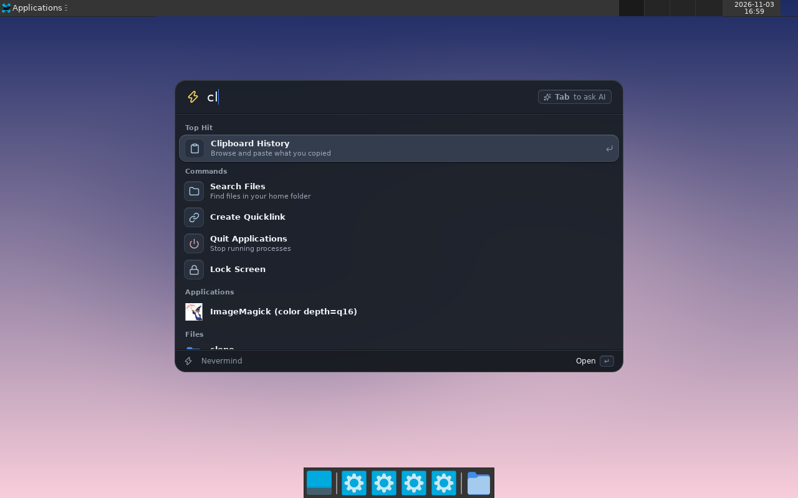
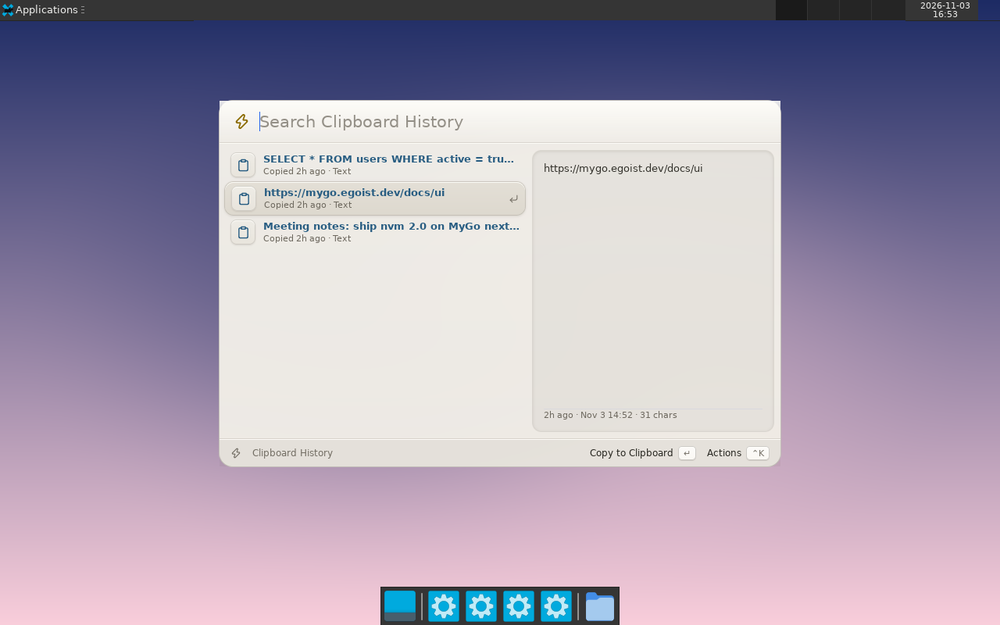
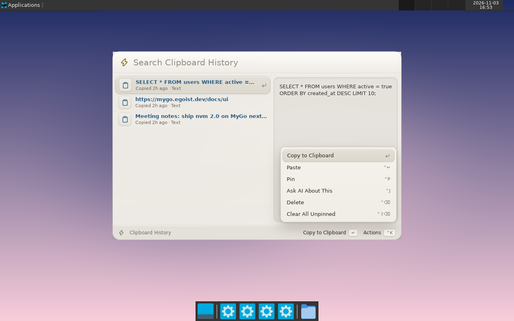

# Nevermind 2.0 in Go (MyGo)

Goal of this directory: **a complete rewrite of Nevermind in Go on [MyGo](https://mygo.egoist.dev)**,
with native UI (GPU-drawn, no Electron, no webview), a breaking "2.0". Nothing here is shared with
`src/app` yet; the Electron app stays as the reference until the rewrite reaches parity.

| | Electron (today) | This rewrite |
|---|---|---|
| Processes | 6 | 1 |
| Memory (idle, hidden, PSS) | ~380 MB | ~90 MB |
| CPU (idle) | 0.4-0.6% | 0.2-0.3% |
| Runtime on disk | 284 MB | ~37 MB binary |

Measured in a Linux container under software rendering; see "Status" for what is and is not verified.

## Look

Same visual identity as `src/app/palette/styles/theme.css` (warm paper + gold accent, ink + gold in dark),
rebuilt as a native panel: frameless, rounded, system material behind it where the OS has one
(`VibrancyGlass`: Liquid Glass on macOS 26, popover material before, Acrylic on Windows 11), system
font, results grouped under Top Hit / Commands / Applications / Files, a status bar with keycaps, and a
`Cmd+K` action menu. Surfaces are flat fills told apart by a lit top edge and a soft shadow, not gradients.

| Light | Dark |
|---|---|
|  |  |
|  |  |

## Behavior kept from the Electron app

- Ranking is a port of `src/app/palette/search-ranking.ts` (`ranking.go`, same score bands).
- Query fallbacks as in `extensions/web-search.ts` and `extensions/ai-builder.ts`: `Search the web for "..."`
  (score 10) and `Automate "..."` (score 40), suppressed for calculator results; URLs give `Open <site>`.
- `Tab` asks AI. Recent chats appear as "Continue conversation".
- Rotating placeholders, empty states, `Cmd+K` actions, per-view shortcuts.

## Features

Palette, apps with icons, file search (in-memory index), clipboard history (text + images, pin, delete,
paste, preview), calculator (math, percentages, units, temperature, hex), emoji and symbols grid,
snippets (keywords), quick notes (autosave, floating window), quit processes, system commands
(lock/sleep/log out/restart/shut down/empty trash with confirmation), timer with tray countdown,
quicklinks and web engines, settings (hotkey, engine, clipboard, launch at login), tray, AI chat
(streams from the Nevermind backend, native Markdown), extension manager.

### Extensions are Go

Extensions are single Go files interpreted at runtime with [Yaegi](https://github.com/traefik/yaegi)
(`ext.go`): `package main`, `import "nvm"`, `func Extension() nvm.Extension`. They get `Search`, `MenuBar`
(tray item refreshed every 10 s) and `nvm.HTTPGet`. See `examples/world-clock.go.txt`
(drop it in `~/.config/nvm-native/extensions/` as a `.go` file).

**Automate with AI**: type anything, choose `Automate "..."`; the model writes the Go extension, Yaegi
checks it, errors go back to the model (two retries), and it is installed live. Verified end to end.

## Run

```sh
cd src/native
go run .          # Alt+Shift+Space opens the palette
NVM_THEME=dark go run .   # force the dark theme for previews
```

Config lives in `~/.config/nvm-native/` (`settings.json`, `clipboard.json`, `snippets.json`, `notes.json`,
`chats.json`, `extensions/`). AI needs `auth.json` (`{"baseUrl","token","email"}`) or `NVM_TOKEN`; the
sign-in flow is not ported yet.

Requires Go (see `go.mod`). On Linux a tray host and a compositor are needed for tray icons and transparency.

## Status

Verified in a Linux container (Xvfb, software GL), by driving the UI and taking screenshots: everything
in "Features". **Not verified**: macOS and Windows at all (vibrancy/glass, system accent, `Cmd` shortcuts,
SF font, `Shell.InstalledApps` icons there), dark theme beyond the palette and clipboard views,
microphone/dictation (not ported), window management (macOS-only in the product; not ported).

## Not ported yet (parity checklist)

- Account: device sign-in, plans/credits UI, BYO key
- AI: model tiers ("Fast"), tool use / agent loop, images, chat retention, conversation actions
- Extension API parity (declarative views, actions, jobs, capabilities, trust model); today only `Search`/`MenuBar`
- Dictation, window management, permissions, updates, keyboard-shortcut manager, background tasks, diagnostics
- Onboarding / "Welcome", hotkey notice, backend status rows
- Packaging, signing, auto-update (`mygo build`), Windows/Linux parity pass, tests (`ui.Tester`)

## Layout

```
main.go        app wiring, window, hotkey, tray
palette.go     view stack, rendering, keys, action menu
providers.go   root search, commands, settings
ranking.go     port of search-ranking.ts
theme.go depth.go   tokens (from theme.css) and surface helpers
clipboard.go emoji.go files.go forms.go system.go calc.go   features
ai.go          chat + extension builder
ext.go         Yaegi runtime and the `nvm` API
```
